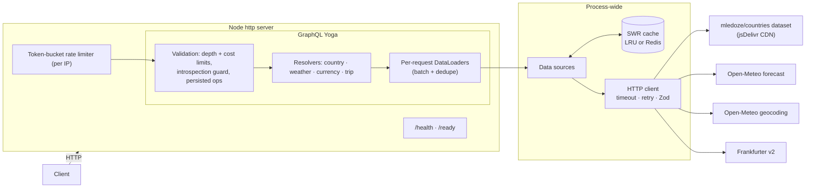

# Travel Insights GraphQL API

A production-style GraphQL aggregation service that combines several free, key-less public APIs
into one typed graph: country reference data, live weather, exchange rates, and a computed
**trip score** that ranks destinations by weather comfort and currency-driven cost.

It is small enough to read in an afternoon, but it deals with the problems real aggregation
gateways have: N+1 fan-out to upstreams, flaky dependencies, cache freshness, abusive queries,
and operability.

**Stack:** TypeScript (strict, ESM) · GraphQL Yoga 6 · graphql-js 17 · schema-first SDL +
GraphQL Code Generator · DataLoader · Zod · pino · Vitest · ESLint (typescript-eslint strict) ·
Prettier · Docker · GitHub Actions

---

## Highlights

| Concern          | Implementation                                                                                                                                                     |
| ---------------- | ------------------------------------------------------------------------------------------------------------------------------------------------------------------ |
| N+1 to upstreams | Per-request DataLoaders. 20 countries × weather becomes **1** Open-Meteo call (multi-coordinate API).                                                              |
| Caching          | Shared LRU cache with per-source TTLs, **stale-while-revalidate**, stale-if-error, and single-flight loads. Redis adapter included.                                |
| Resilience       | Per-attempt timeouts, retries with exponential backoff + full jitter (transient errors only), Zod-validated upstream responses.                                    |
| Error model      | Typed errors mapped to `extensions.code`: `BAD_USER_INPUT`, `NOT_FOUND`, `UPSTREAM_UNAVAILABLE`, `QUERY_TOO_COMPLEX`. Everything else is masked.                   |
| Partial failure  | A failing upstream nulls only the affected field. `compareDestinations` degrades to the remaining signal and reports `warnings`.                                   |
| Abuse protection | Depth limit, directive-driven **cost analysis** (`@cost` / `@listSize`), per-IP token-bucket rate limiting, introspection off in production, persisted operations. |
| Operability      | `/health` + `/ready`, graceful shutdown with connection draining, structured logs with operation name, duration, error codes, and request ID.                      |
| Delivery         | Multi-stage non-root Docker image, compose file, CI on Node 22 & 24 (codegen drift check, lint, typecheck, test, build, image build).                              |

## Architecture



Request flow: each request gets **fresh DataLoaders**, so memoization never leaks between users.
DataLoaders call **process-wide data sources**, which share one cache and one HTTP client per
upstream.

### Upstreams

| Source                                                                          | Used for                                 | TTL (+ SWR window)       |
| ------------------------------------------------------------------------------- | ---------------------------------------- | ------------------------ |
| [mledoze/countries](https://github.com/mledoze/countries) `@5.1.0` via jsDelivr | Countries, capitals, currencies, borders | 24h (+24h)               |
| [Open-Meteo geocoding](https://open-meteo.com/en/docs/geocoding-api)            | Capital coordinates                      | 7d (+7d)                 |
| [Open-Meteo forecast](https://open-meteo.com/en/docs)                           | Current weather + 7-day forecast         | 10m (+10m)               |
| [Frankfurter v2](https://frankfurter.dev)                                       | Latest and historical FX rates           | 1h (+1h); historical 24h |

> **Why not REST Countries?** In 2026 `restcountries.com` retired `/v1`–`/v4`, and its new `/v5`
> requires an API key. The service uses the open dataset that REST Countries v3 was built on
> instead, pinned to a tagged release on a CDN. Because it is a single static document, it is
> fetched once and indexed in memory. Likewise, Frankfurter moved to `api.frankfurter.dev`;
> v1 only covers ~30 ECB currencies, so **v2** (~165 currencies, including UZS and KZT) is used.

## Design decisions

### Schema-first with generated resolver types

Each module owns its SDL in `typeDefs.ts` and extends shared types (`extend type Country`).
GraphQL Code Generator plucks the SDL and generates `Resolvers` types. `mappers` bind GraphQL
types to internal domain models (`Country → CountryModel`), so a resolver's `parent` is the
domain object, not the GraphQL shape. CI regenerates the types and fails on drift.

### DataLoader: batching that maps to real upstream batching

DataLoader only helps if the batch function can actually batch. Here it can:

- **Weather:** Open-Meteo accepts comma-separated coordinates. Every `weather` and
  `capitalWeather` field resolved in the same tick becomes **one** request (chunked at 50
  points). Points are keyed on a ~1 km grid, so duplicates are deduplicated and the cache hit
  rate improves.
- **FX:** `Currency.rate(base)` is keyed by `base`. One Frankfurter call returns every quote, so
  a full page of countries (and their neighbours) costs one request.
- **Countries:** lookups by alpha-2 or alpha-3 code resolve against the cached index.
  `Country.borders` therefore never fans out.
- **Geocoding** has no batch endpoint. DataLoader still deduplicates per request, and results
  (including "not found") are cached for 7 days.

This is verified by tests that assert upstream call counts (`test/integration/batching.test.ts`).
Live, a 20-country query with weather and FX rates made **1** upstream call when FX was
already cached, and **0** on repeat.

### Cache: stale-while-revalidate with single-flight

`SwrCache.getOrLoad(key, { ttlMs, staleWhileRevalidateMs }, loader)`:

- **fresh**: return the cached value.
- **stale**: return the cached value immediately and refresh once in the background.
  Concurrent readers share that one refresh.
- **miss**: load once. Concurrent callers share the in-flight promise (no thundering herd).
- **refresh fails**: keep serving stale until the window closes (stale-if-error).

Storage sits behind a 3-method `CacheStore` interface. `InMemoryLruStore` is the default (zero
infrastructure). `RedisCacheStore` works with any ioredis or node-redis client, so several
replicas can share a cache. Entries carry absolute `freshUntil` and `staleUntil` timestamps, so
any store works.

### Resilient HTTP client

`HttpClient.getJson(url, zodSchema)`:

- Applies a per-attempt `AbortSignal.timeout`.
- Retries only transient failures (network errors, timeouts, 408/425/429/5xx), using
  exponential backoff with **full jitter**.
- Validates every response with Zod, so if an upstream changes its shape, the client gets a
  clean `UPSTREAM_UNAVAILABLE` instead of a `TypeError` deep in a resolver.
- Lets data sources translate meaningful statuses. For example, Frankfurter's `422 invalid
currency` becomes `BAD_USER_INPUT`.

### Query cost analysis

Depth limits alone do not stop `countries(first: 50) { nodes { borders { borders { capitalWeather } } } }`,
which is shallow but fans out to thousands of upstream lookups. A custom validation rule
computes

```
cost(field) = @cost weight (default 1 for objects, 0 for scalars)
            + listMultiplier × cost(children)
```

where `@listSize(slicingArgument: "first", assumedSize: 50)` takes the multiplier from the
argument literal, its default, or a pessimistic assumed size when the argument is a variable.
This matters because validation runs before variables are known, and Yoga caches validation
results per document. Aliases are costed individually, which blocks alias amplification.
Over-budget operations are rejected before any resolver runs.

### Trip score: a pure domain service

`modules/trip/scoring.ts` has no I/O and is fully unit-tested:

- **Weather (0–100):** daytime temperature (`0.7·max + 0.3·min`) scores 1.0 inside 18–26 °C
  and falls linearly to 0 at 10 °C outside the band. Each day is discounted by rain
  (showers ×0.8, wet ×0.5). The score is averaged over the 7-day forecast.
- **Cost (0–100):** the change in "destination units per 1 home-currency unit" against
  90 days ago. 50 means unchanged purchasing power; +10% maps to 100 and −10% to 0.
  This is an honest, data-backed signal (it measures FX momentum, not price levels).
- **Total:** a weighted mean (default 0.6 / 0.4, overridable). If one component is
  unavailable, the remaining weights are renormalized, so an FX outage still yields a
  weather-based ranking.

`compareDestinations` costs **2 FX calls + 1 batched forecast call**, no matter how many
destinations it compares (up to 10).

## Example queries

All outputs below are real responses captured on 2026-10-23.

**A country with capital weather and live FX**

```graphql
query Uzbekistan {
  country(code: "UZ") {
    name
    capital
    flag
    capitalWeather {
      location {
        name
      }
      current {
        temperature
        condition
      }
      daily(days: 3) {
        date
        temperatureMin
        temperatureMax
        condition
      }
    }
    currencies {
      code
      name
      rate(base: "USD")
    }
  }
}
```

```json
{
  "data": {
    "country": {
      "name": "Uzbekistan",
      "capital": "Tashkent",
      "flag": "🇺🇿",
      "capitalWeather": {
        "location": { "name": "Tashkent" },
        "current": { "temperature": 15.2, "condition": "Clear sky" },
        "daily": [
          {
            "date": "2026-10-23",
            "temperatureMin": 8,
            "temperatureMax": 20.5,
            "condition": "Partly cloudy"
          },
          {
            "date": "2026-10-24",
            "temperatureMin": 6,
            "temperatureMax": 17.3,
            "condition": "Clear sky"
          },
          {
            "date": "2026-10-25",
            "temperatureMin": 5.9,
            "temperatureMax": 17.6,
            "condition": "Clear sky"
          }
        ]
      },
      "currencies": [{ "code": "UZS", "name": "Uzbekistani soʻm", "rate": 11936 }]
    }
  }
}
```

**Compare destinations**

```graphql
query Compare {
  compareDestinations(codes: ["UZ", "TR", "JP"]) {
    best {
      country {
        name
      }
      score
    }
    destinations {
      rank
      country {
        code
      }
      score
      weatherScore
      costScore
      currency
      exchangeRate
      fxChange90d
      summary
      warnings
    }
  }
}
```

```json
{
  "data": {
    "compareDestinations": {
      "best": { "country": { "name": "Türkiye" }, "score": 67 },
      "destinations": [
        {
          "rank": 1,
          "country": { "code": "TR" },
          "score": 67,
          "weatherScore": 62,
          "costScore": 74.6,
          "currency": "TRY",
          "exchangeRate": 49.633,
          "fxChange90d": 4.93,
          "summary": "Mild and mostly dry (avg high 18°C, 2 rainy days); USD up 4.9% vs TRY over 90d",
          "warnings": []
        },
        {
          "rank": 2,
          "country": { "code": "UZ" },
          "score": 61.2,
          "weatherScore": 71.9,
          "costScore": 45.1,
          "currency": "UZS",
          "exchangeRate": 11936,
          "fxChange90d": -0.99,
          "summary": "Mild and dry (avg high 19°C, 0 rainy days); USD down 1.0% vs UZS over 90d",
          "warnings": []
        },
        {
          "rank": 3,
          "country": { "code": "JP" },
          "score": 44.2,
          "weatherScore": 53.4,
          "costScore": 30.3,
          "currency": "JPY",
          "exchangeRate": 157.26,
          "fxChange90d": -3.95,
          "summary": "Mild and wet (avg high 20°C, 5 rainy days); USD down 3.9% vs JPY over 90d",
          "warnings": []
        }
      ]
    }
  }
}
```

**Cursor pagination and conversion**

```graphql
query Asia($after: String) {
  countries(filter: { region: "Asia" }, first: 20, after: $after) {
    totalCount
    pageInfo {
      hasNextPage
      endCursor
    }
    nodes {
      code
      weather {
        current {
          temperature
        }
      }
      currencies {
        code
        rate(base: "USD")
      }
    }
  }
  convert(amount: 250, from: "EUR", to: "UZS") {
    rate
    result
    date
  }
}
```

```json
{
  "data": {
    "countries": {
      "totalCount": 50,
      "pageInfo": { "hasNextPage": true, "endCursor": "Y291bnRyeTpLVw" },
      "nodes": [
        {
          "code": "AF",
          "weather": { "current": { "temperature": 14.2 } },
          "currencies": [{ "code": "AFN", "rate": 64.957 }]
        },
        {
          "code": "AM",
          "weather": { "current": { "temperature": 11.5 } },
          "currencies": [{ "code": "AMD", "rate": 360.98 }]
        }
      ]
    },
    "convert": { "rate": 13397, "result": 3349250, "date": "2026-10-23" }
  }
}
```

**Errors carry stable codes**

```jsonc
// { country(code: "XX") { name } }
{ "errors": [{ "message": "Country \"XX\" not found", "path": ["country"], "extensions": { "code": "NOT_FOUND" } }], "data": { "country": null } }

// borders nested 8 levels deep: rejected during validation, before any upstream call
{ "errors": [
  { "message": "Query depth 9 exceeds the maximum allowed depth of 8", "extensions": { "code": "QUERY_TOO_COMPLEX", "depth": 9, "maxDepth": 8 } },
  { "message": "Query cost 39063 exceeds the maximum allowed cost of 1500", "extensions": { "code": "QUERY_TOO_COMPLEX", "cost": 39063, "maxCost": 1500 } }
] }
```

## Quick start

Requirements: Node.js ≥ 22.15. No database, Redis, or API keys are needed.

```bash
npm install
npm run dev          # http://localhost:4000/graphql (GraphiQL enabled outside production)
```

Production build:

```bash
npm run build && NODE_ENV=production npm start
```

Docker:

```bash
docker compose up --build
curl -s localhost:4000/graphql -H 'content-type: application/json' \
  -d '{"query":"{ country(code: \"UZ\") { name capital } }"}'
```

## Configuration

Every variable is optional and validated with Zod at startup (`src/config.ts`). An invalid
value fails fast with a readable message. See [`.env.example`](.env.example) for the full list.

| Variable                                                        | Default              | Purpose                                             |
| --------------------------------------------------------------- | -------------------- | --------------------------------------------------- |
| `PORT` / `HOST`                                                 | `4000` / `0.0.0.0`   | Listen address                                      |
| `NODE_ENV`                                                      | `development`        | `production` disables introspection and GraphiQL    |
| `LOG_LEVEL`                                                     | `info`               | pino level (`debug` logs every upstream call)       |
| `CORS_ORIGINS`                                                  | `*`                  | Comma-separated allowed origins                     |
| `TRUST_PROXY`                                                   | `false`              | Use `X-Forwarded-For` for rate-limit keys           |
| `RATE_LIMIT_CAPACITY` / `RATE_LIMIT_REFILL_PER_SEC`             | `60` / `1`           | Token bucket per IP                                 |
| `MAX_QUERY_DEPTH` / `MAX_QUERY_COST`                            | `8` / `1500`         | Validation limits                                   |
| `GRAPHQL_INTROSPECTION`                                         | env-dependent        | Explicit override                                   |
| `PERSISTED_OPERATIONS_FILE` / `PERSISTED_OPERATIONS_ONLY`       | unset / `false`      | `{ "<sha256>": "<query>" }` allow-list              |
| `HTTP_TIMEOUT_MS` / `HTTP_RETRIES` / `HTTP_RETRY_BASE_DELAY_MS` | `5000` / `2` / `150` | Upstream client                                     |
| `CACHE_MAX_ENTRIES`, `CACHE_TTL_*_MS`                           | see `.env.example`   | Cache sizing and per-source TTLs                    |
| `*_URL`                                                         | public endpoints     | Upstream base URLs (point them at mocks or mirrors) |

## Testing

```bash
npm test               # 87 tests, ~1s, no network access
npm run test:coverage
```

- **Unit:** trip scoring, SWR cache (TTL, background revalidation, stale-if-error,
  single-flight, LRU eviction, Redis adapter), retry/backoff, HTTP client (retry policy,
  timeout, schema mismatch), cursor pagination, token bucket, depth and cost rules, config.
- **Integration:** real GraphQL operations executed against the Yoga instance, with every
  upstream replaced by an **injected fake `fetch`** that counts calls and rejects any
  unexpected outbound request. This covers:
  - DataLoader batching (asserted upstream call counts)
  - per-request deduplication and cross-request caching
  - retries, partial failure, and stale-on-outage
  - error masking
  - depth and cost rejection, introspection in production, and persisted operations
  - rate limiting, probes, CORS, and shutdown, run on a real HTTP server bound to an
    ephemeral local port

## Project structure

```
src/
├── index.ts                 # bootstrap: config, logger, listen, warmup, signal handling
├── app.ts                   # composition root: cache, HTTP clients, data sources, Yoga
├── server.ts                # node:http server: probes, rate limiting, graceful shutdown
├── config.ts                # Zod-validated environment
├── context.ts               # per-request context + fresh DataLoaders
├── graphql/
│   ├── typeDefs.ts          # base schema + @cost / @listSize directives
│   ├── schema.ts            # merges module SDL + resolvers
│   ├── validation.ts        # depth-limit and cost-limit validation rules
│   └── plugins.ts           # limits, operation logging, introspection, persisted ops
├── modules/
│   ├── country/             # typeDefs, resolvers, datasource, loaders, model, pagination
│   ├── weather/             # forecast (batched) + geocoding, WMO code mapping
│   ├── currency/            # Frankfurter v2 rates, conversion
│   └── trip/                # scoring.ts (pure) + service.ts (orchestration)
├── shared/                  # http-client, retry, cache, rate-limiter, errors, logger, clock
└── generated/graphql.ts     # graphql-codegen output (committed, drift-checked in CI)
test/
├── unit/                    # pure logic
├── integration/             # GraphQL operations with faked upstreams
├── helpers/                 # fake upstreams, test app factory, fake clock
└── fixtures/countries.json  # 27 real records from the dataset
```

## Production notes and trade-offs

- **Per-instance state.** The in-memory cache and rate limiter are per process. With
  multiple replicas, use `RedisCacheStore` (already implemented) and move rate limiting to
  Redis or the edge. The interfaces are designed for that swap.
- **Trust boundaries.** `X-Forwarded-For` is ignored unless `TRUST_PROXY=true`, so clients
  cannot spoof their rate-limit key.
- **Readiness.** `/ready` turns `200` after the country dataset warmup is attempted, and
  turns `503` as soon as shutdown begins, so load balancers stop routing before connections
  are drained.
- **Persisted operations.** In production, set `PERSISTED_OPERATIONS_ONLY=true` with a
  client-generated manifest. Only known, pre-costed documents can then run.

## License

[MIT](LICENSE) © 2026 Yusuf Yuldashev
